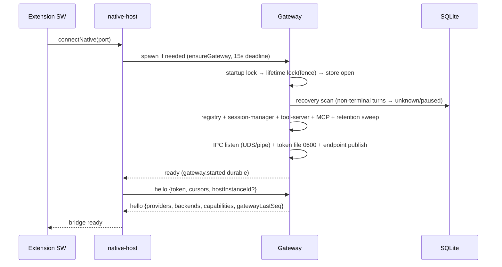
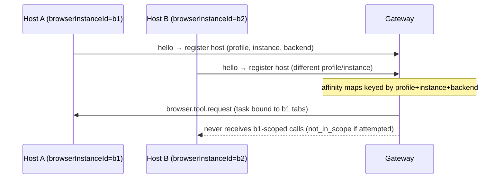
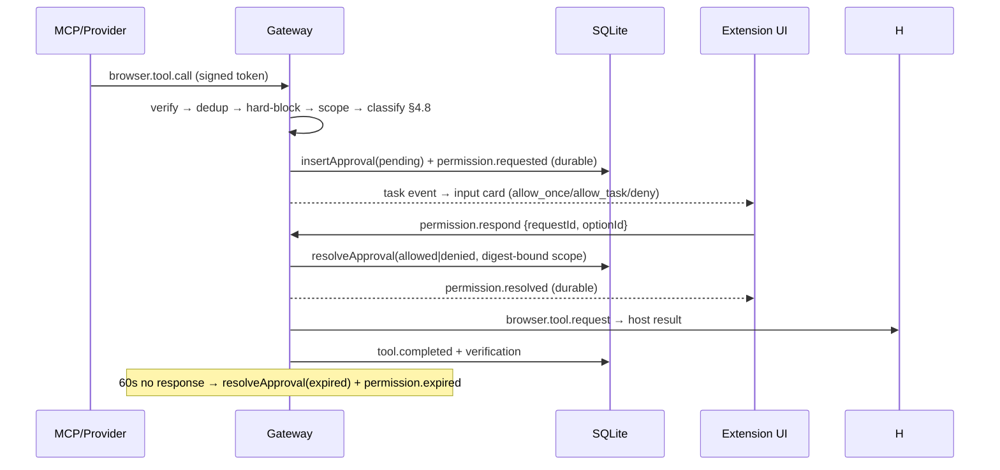
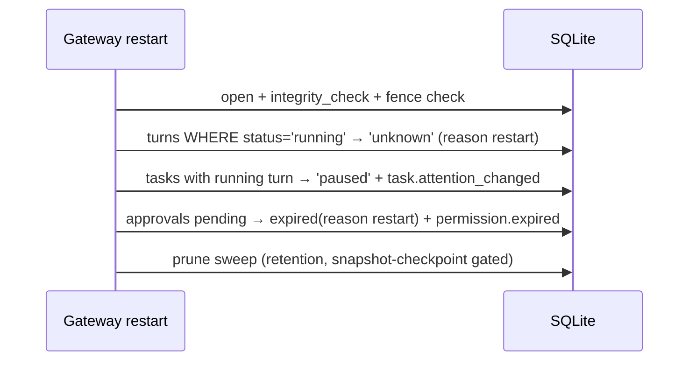
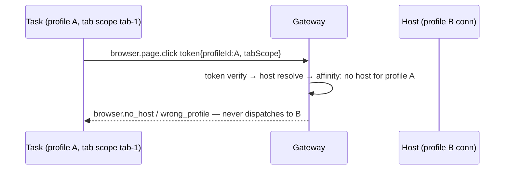

# Gate C artifacts — Chromex Gateway

Plan §12 Gate C: C1 file-by-file change list, C2 sequence diagrams,
C3 test-case matrix, C4 contract consistency check.
C4: `node scripts/plan/check-plan-consistency.mjs` → **30/30 pass**
(incl. `--self-test` per bead chromex-gs6 note; run 2026-11-07 @d61d70e).

Status: artifacts prepared 2026-11-07. Sign-off gated on
MVP-accept (chromex-frg), which now runs against the 8-scenario
product acceptance matrix (chromex-ov1,
[docs/product-acceptance-matrix.md](product-acceptance-matrix.md)).

## MVP acceptance — 8 scenarios (supersedes plan §14 12-criteria list)

Per [docs/product-acceptance-matrix.md](product-acceptance-matrix.md):
no capability counts as done until an end-to-end user scenario passes
on a real browser. The 8 gate scenarios are S1–S8; APIs, classes, and
unit tests are necessary, not sufficient.

| # | Scenario | Blocking work |
|---|----------|----------------|
| S1 | Build a web feature end-to-end (understand → edit → run → drive UI → iterate → report) | chromex-cl0, chromex-d9o |
| S2 | Debug a live website on a logged-in tab | chromex-cl0, chromex-d9o |
| S3 | Multi-tab/multi-app work without scope bleed | chromex-7k3 |
| S4 | Real web workflow: logged-in session, multi-step form, file use, auth handoff | chromex-d7v |
| S5 | Interruption recovery: close panel / kill SW / restart gateway mid-turn → resume without duplicates | partially evidenced (recovery tests); real-Chrome legs pending |
| S6 | Failed plan: stale selector / UI change / tool failure → re-observe, re-plan, never fake success | needs failed-plan handling proof |
| S7 | Protection: sensitive actions → contextual approval; denial honored | partially evidenced (approval flows) |
| S8 | Verifiable deliverable rendered in sidepanel | chromex-5rf |

Old §14 criteria → new mapping:

| Old # | Old criterion | Disposition |
|---|---|---|
| 1 | Control real logged-in Chrome tab | Covered by S2/S4 real-browser runs |
| 2 | No auto-open separate browser for default tasks | Covered — precondition of S1–S4 real-browser runs |
| 3 | Codex create/send/stream/interrupt/resume | Superseded — exercised implicitly by every scenario's provider leg |
| 4 | Claude spike ADR + Phase 3 adapter | Superseded as gate item; still required per provider contract (Phase beads) |
| 5 | Browser tools list/get/snapshot/click/type/fill/select/scroll/navigate/wait (+screenshot) | Prerequisite to S1–S4; unit/integration evidence exists, live proof comes via scenarios |
| 6 | SW sleep + panel close + hostInstanceId + gateway crash → paused+resume | Covered by S5 |
| 7 | Approval for mutation/sensitive/egress; financial never auto | Covered by S7 |
| 8 | No provider/profile/tab-scope mixing | Covered by S3 (scope bleed) + S7 (profile isolation) |
| 9 | Verified or typed error | Covered by S6 (never fake success) + S8 (honest evidence) |
| 10 | Playwright capability intact + isolated opt-in | Superseded as gate item; keep as regression check only |
| 11 | Durable seq no-gap under delta drop | Prerequisite to S5; already verified (delta-coalescer tests) |
| 12 | Post-prune snapshot retains user+assistant messages | Prerequisite to S5/S8; already verified (snapshot tests) |

---

## C1. File-by-file change list (as implemented)

### PR-A — contracts + planner policy + ADRs (Phase 0)

- `packages/shared/src/protocol/*` — envelope unions, error registry,
  protocol errors (`EphemeralDiagnosticsEnvelope` added P2-08)
- `packages/shared/src/agent/*` — provider/session/event/turn-input/
  permission/capabilities/persistence/catalog/commands/usage/modes/
  provider-id contracts
- `packages/shared/src/browser/*` — risk classifier, fingerprint
  (`sfp1:`/`tfp1:` two-fingerprint model + HMAC field hashes, P2-01)
- `packages/shared/src/tasks/*` — task/turn records, attention
- `packages/bridge/src/agentic-router.ts`, `packages/shared/src/
  agentic-route.ts` — `browserPolicyV2` flag: model cannot pick engine
- `packages/extension/src/background/index.ts`, `storage.ts`,
  `sidepanel/index.ts`, `types.ts` — caps + settings plumbing
- `docs/adr/*` — browser-instance, ipc-transport, durability,
  playwright-snapshot, mcp-endpoint, claude-mechanism, acp-provider,
  background-turns (all now versioned)
- Tests: `packages/shared/test/*` contract suites

### PR-B — Codex provider wrap (P1-05, conformance GateB-B1)

- `packages/bridge/src/agents/providers/codex/{provider,session,
  mapper,features}.ts` — app-server thread/turn lifecycle, steer,
  interrupt w/ terminal-ownership wait, requestUserInput→permission,
  `provider.feature.codex.*` schema-validated features
- `packages/bridge/src/agents/{registry,catalog-cache}.ts`
- `packages/bridge/test/{codex-session,codex-mapper,codex-features,
  codex-fixtures,conformance/agent-session}.ts`
- Untouched: `codex-plane.ts` legacy path stays for sidecar mode

### PR-C — Gateway skeleton + IPC + native relay (P1-01/03/04)

- `packages/bridge/src/gateway/{main,config,hello,lock,ipc-server,
  ipc-client,bin,diagnostics,compat}.ts`
- `packages/native-host/src/{relay,gateway-client}.ts` — NM↔socket
  relay, `CHROMEX_GATEWAY_MODE` flag, single-hello auth
- `packages/bridge/src/store/{db,schema,recovery,retention,
  snapshot-builder}.ts`, `sqlite-store.ts`
- `packages/bridge/src/gateway/store-memory.ts` — in-memory store
- Tests: `test/gateway.test.ts` (locks/fence/recovery),
  `test/gateway-rpc.test.ts`, native-host relay tests

### PR-D — SQLite store + state machines + replay + compat (P1-02/06/07/11)

- `packages/bridge/src/gateway/{session-manager,snapshot-builder,
  store-memory}.ts`, `store/{sqlite-store,schema,recovery,retention}.ts`
- `packages/bridge/src/gateway/compat.ts` — LEGACY_COMPAT map +
  LEGACY_SIDECAR_METHODS (§10)
- `task.purge`, `task.snapshot.chunk`, `provider.catalog`,
  `config.read/update`, `diagnostics.snapshot` RPCs
- Tests: session-manager, retention, snapshot merge tests

### PR-E — extension gateway client + task controller + UI sync (P1-08/10)

- `packages/extension/src/gateway/{identity,gateway-client,
  task-controller,runtime,legacy-events}.ts`, `tool-host.ts`
- `packages/extension/src/background/message-guard.ts` (P5-02)
- sidepanel: gatewayTasks state, Isolated badge, attention badges,
  plan-input card reuse for permissions
- `setGatewayDelegate` — legacy bridge.request → Envelope when
  gatewayMode on
- Tests: `test/gateway*.test.ts`, `message-guard.test.ts`

### PR-F — browser tool server + policy + verify/stale (P1-09, P2-*)

- `packages/bridge/src/browser/{tool-token,tool-server,host-registry,
  backend-selection,mcp-server,mcp-stdio,mcp-scope,tab-binding}.ts`
- `packages/bridge/src/browser/backends/playwright/isolated.ts` +
  `PlaywrightRuntimeManager` (separate)
- `packages/bridge/src/browser/{refs,snapshot,actions,verify,
  transport}.ts` (content split from index.ts, P2-01)
- `packages/extension/src/background/gateway/tool-host.ts` —
  browser.* → chrome.tabs/content-script dispatch
- `packages/extension/src/content/*` — fingerprint, verify, transport,
  snapshot modules
- `packages/shared/src/browser/risk.ts` — §4.8 classifier
- Tests: tool-server, tool-token, host-registry, tab-binding,
  backend-selection, playwright-isolated, verify-rules, fingerprint,
  real-Chromium E2E script

### PR-G — budgets/coalescing/throttle (P2-06)

- `packages/bridge/src/gateway/delta-coalescer.ts`
- turn timeout in session-manager; `cancelForTask` in tool-server
- `test/delta-coalescer.test.ts`

### PR-H — Claude provider (P3-01..07)

- `packages/bridge/src/agents/providers/claude/{provider,session,
  mapper}.ts` — SDK query() + prompt queue, per-turn UUID bind,
  canUseTool→permission, interrupt ownership, resume session_id
- provider picker UI: `agentProviderId` setting → composer select
  (only when gatewayMode && providers>1)
- `test/claude-session.test.ts` (29 tests + conformance)

### PR-I — Phase 4 ACP providers + Phase 5 cleanup (P4, P5)

- `packages/bridge/src/agents/providers/acp/{client,mapper,session,
  provider}.ts` — generic ACP adapter; `config.providers.acp` entries
- `docs/adr/{acp-provider,background-turns}.md`
- `packages/extension/src/background/message-guard.ts`
- `.gitignore` docs/adr un-ignored
- `test/acp-session.test.ts` + `fixtures/fake-acp-agent.mjs`,
  `test/message-guard.test.ts`

---

## C2. Sequence diagrams

### Cold start (gatewayMode=on)



### Concurrent host (two Chrome instances/profiles)



### Gateway crash mid-turn

```mermaid
sequenceDiagram
  participant P as Provider
  participant GW as Gateway (dies)
  participant DB as SQLite
  P--xGW: stream cut
  Note over DB: last durable seq preserved; turn stays "running"
  participant GW2 as Gateway (restart)
  GW2->>DB: recovery scan → turn non-terminal → turn.unknown / task paused
  GW2->>GW2: fence token rotated; stale owner self-terminates
  Ext->>GW2: reconnect hello (new token) + cursors
  GW2-->>Ext: task.sync replay from lastAck + snapshot fallback
```

### Host loss (SW sleep / Chrome quit)

```mermaid
sequenceDiagram
  participant H as Host conn
  participant GW as Gateway
  participant R as HostRegistry
  H--xGW: disconnect
  GW->>R: mark host offline; stranded tabs stay bound (no reassignment)
  Note over GW: in-flight dispatch → outcome "unknown" (host_lost_after_dispatch)
  H->>GW: reconnect hello same browserInstanceId
  GW->>R: affinity restored; degraded mode if instance null → needs_confirmation
```

### Permission (browser action needing approval)



### Crash recovery detail



### Cross-profile isolation



---

## C3. Test-case matrix (input → events → DB rows)

Representative; full coverage lives in the cited test files.

| # | Input | Expected events | DB effect | Test |
|---|-------|-----------------|-----------|------|
| 1 | `task.create` | task.created, task.attention_changed | tasks row, seq=1 | gateway-rpc |
| 2 | `task.send` valid | user.message.created, turn.started, provider events…, turn.completed | turns row terminal, events seq contiguous | gateway-e2e (live), session-manager |
| 3 | `task.send` duplicate clientMessageId | task.event duplicate flag, NO new turn | idempotency: no second turn row | gateway tests |
| 4 | SIGKILL mid-turn → restart | recovery: turn.unknown, task paused | turns.status=unknown, tasks.status=paused | gateway.test.ts + live e2e |
| 5 | reconnect hello cursors | task.sync replay ≥ cursor; snapshot if pruned | read-only | task-controller tests |
| 6 | `browser.tool.call` mutating, no approval | permission.requested → (respond) → tool.completed | approvals row resolved; permission.resolved durable | gateway-rpc approval test |
| 7 | approval timeout 60s | permission.expired | approvals.status=expired | code path (poll loop) |
| 8 | hard-block tool (evaluate/cookies) | tool.completed failed `browser.hard_blocked` | tool outcome recorded | tool-server tests |
| 9 | token bad signature/expired/scope | proto.auth_failed/invalid | none | tool-token tests |
| 10 | host disconnect mid-dispatch | tool.completed outcome=unknown | outcome unknown (never faked) | tool-server tests |
| 11 | delta flood > per-turn cap | gateway.notice deltas_dropped | ephemeral only, no seq | delta-coalescer tests |
| 12 | `task.purge` | gateway.task_purged tombstone | cascade delete events/turns/approvals/artifacts | retention tests |
| 13 | retention sweep | (none user-visible) | archived=1 marker; events intact | retention tests |
| 14 | second gateway instance | proto.lock_held / no spawn | lifetime flock blocks | gateway.test.ts |
| 15 | stale fence write | StaleFenceError → self-shutdown | no partial writes | gateway.test.ts |
| 16 | `task.setBackend` from host conn | proto.forbidden | audit event only for user | gateway-rpc |
| 17 | backend pinned unavailable | browser.backend_unavailable, NO fallback | task.backend pinned | backend-selection tests |
| 18 | backend mismatch intent | browser.backend_mismatch | none | backend-selection tests |
| 19 | Claude canUseTool deny | permission.requested→resolved; turn continues | provider mirror only | claude-session tests |
| 20 | ACP session/request_permission | permission.requested→respond→tool outcome | same approval pipeline | acp-session tests |
| 21 | provider resume stale ref | turn.failed provider.stale_resume | honest failure | claude/codex session tests |
| 22 | `permission.respond` allow_task | scope derived from stored request digest | approvals.decision.scope | gateway-rpc |
| 23 | content-script sends prompt.send | "message rejected" | none | message-guard tests |
| 24 | post-prune snapshot | user+assistant messages retained | snapshot = checkpoint+retained events | snapshot tests |

Environment-pending rows (honest): real-Chrome SW-kill cycle (#4 variant
on extension host), Windows ACP/Claude e2e (chromex-xki — env requirements
and skip conditions in [docs/testing-windows-e2e.md](testing-windows-e2e.md)),
live opencode turn (stale creds).
